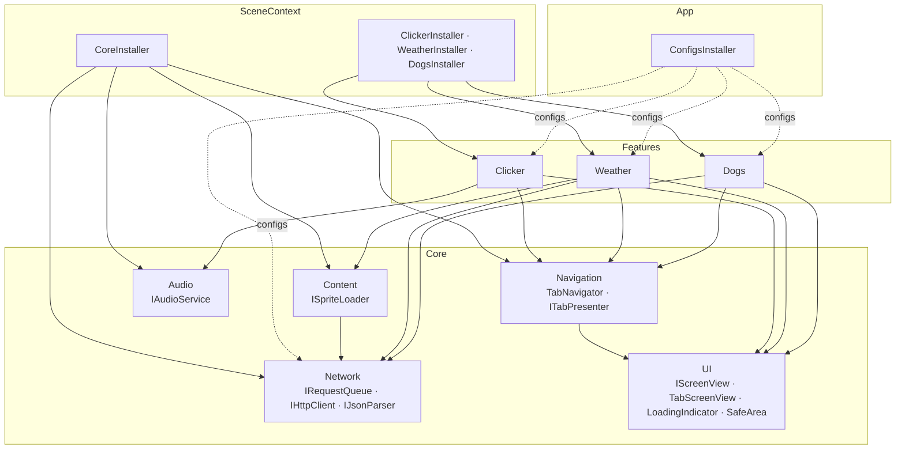
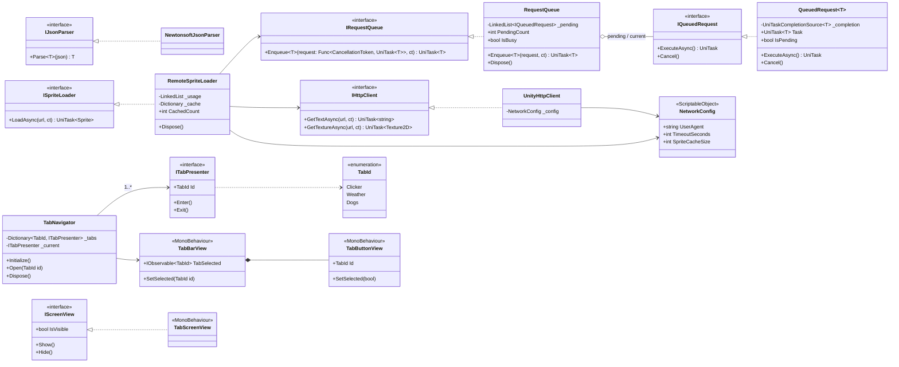
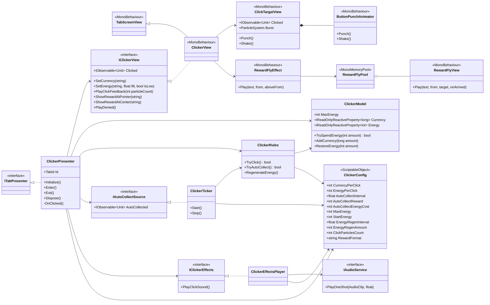
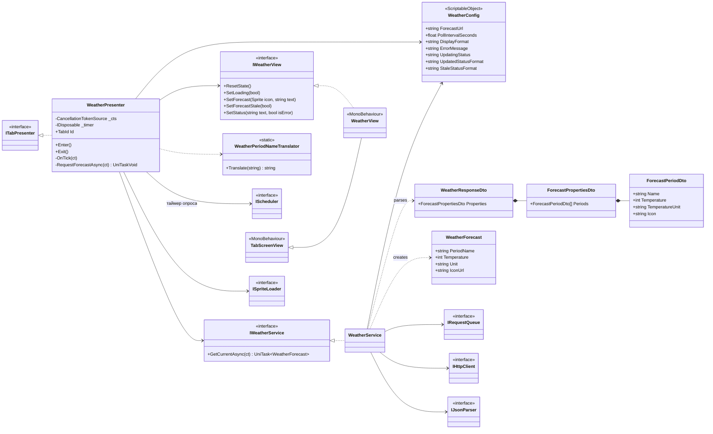
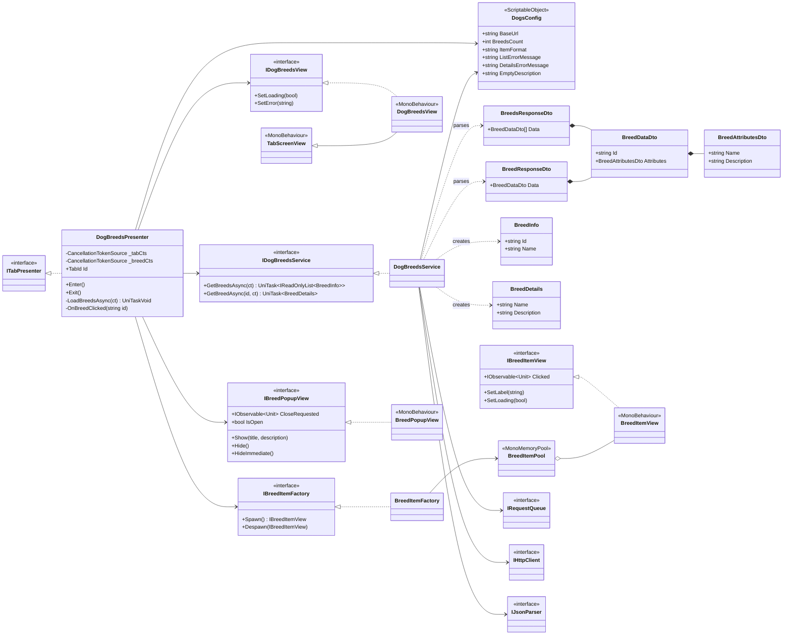
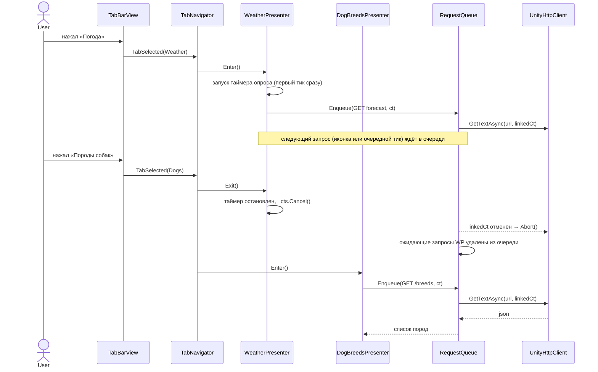

# Архитектура проекта — CKR System

Структура проекта, описание классов и UML-диаграммы (соответствует текущей реализации).
Стек: Unity 6000.5.6f1 (URP 2D), Zenject (Extenject), UniTask, UniRx, DOTween, TextMesh Pro, Input System, UnityWebRequest, Newtonsoft.Json.

## 1. Принципы

- **MVP.** View — `MonoBehaviour`: только отрисовка и события ввода. Presenter — чистый C#: связывает View с Model и сервисами. Model и сервисы — чистый C# без зависимостей от сцены.
- **Презентеры зависят от интерфейсов View** (`IClickerView`, `IWeatherView`, `IDogBreedsView`, `IBreedPopupView`, `IBreedItemFactory`), а не от `MonoBehaviour`. Поэтому они покрыты EditMode-тестами с фейковыми View.
- **Логика — в презентерах, во View — только отображение.** Тексты и форматы строк лежат в конфигах, View получает готовые строки.
- **Без синглтонов и статики.** Все зависимости внедряются через Zenject. `AsSingle()` — это время жизни в DI-контейнере, а не паттерн Singleton.
- **Вкладка — это пара Presenter + View** с жизненным циклом `Enter()` / `Exit()`. Всё, что вкладка запускает (таймеры, запросы), принадлежит её `CancellationTokenSource` и отменяется в `Exit()`.
- **Все HTTP-запросы идут через `IRequestQueue`.** Очередь выполняет их строго по одному. Отмена через `CancellationToken`: если запрос ещё ждёт в очереди, он удаляется оттуда; если уже выполняется, вызывается `UnityWebRequest.Abort()`.
- **Конфигурация хранится в ScriptableObject.** В коде нет магических чисел: стоимости, награды, интервалы, URL и тексты лежат в конфигах.
- **Повторяющиеся объекты — из пулов Zenject** (`MonoMemoryPool`): строки списка пород и вылетающие награды кликера.
- **Фичи не зависят друг от друга.** Каждая фича (`Clicker`, `Weather`, `Dogs`) зависит только от `Core`.

## 2. Структура папок

Namespace повторяет путь к файлу внутри `Scripts/Runtime` (например, `Features/Clicker/View/ClickerView.cs` → `TestTask.Features.Clicker.View`).

```
Assets/
├── _Project/
│   ├── Scripts/Runtime/                  TestTask.Runtime.asmdef
│   │   ├── App/
│   │   │   └── Installers/               ConfigsInstaller (ScriptableObjectInstaller, корень композиции)
│   │   ├── Core/
│   │   │   ├── Installers/               CoreInstaller
│   │   │   ├── Network/                  IRequestQueue, RequestQueue, IQueuedRequest, QueuedRequest<T>,
│   │   │   │                             IHttpClient, UnityHttpClient, IJsonParser, NewtonsoftJsonParser,
│   │   │   │                             NetworkConfig, HttpRequestException
│   │   │   ├── Navigation/               TabId, ITabPresenter, TabNavigator
│   │   │   │   └── View/                 TabBarView, TabButtonView
│   │   │   ├── UI/                       IScreenView, TabScreenView, ScreenTitleView,
│   │   │   │                             LoadingIndicatorView, SafeAreaFitter
│   │   │   ├── Audio/                    IAudioService, AudioService
│   │   │   └── Content/                  ISpriteLoader, RemoteSpriteLoader
│   │   └── Features/
│   │       ├── Clicker/
│   │       │   ├── Config/               ClickerConfig
│   │       │   ├── Model/                ClickerModel
│   │       │   ├── Logic/                ClickerRules, ClickerTicker, IAutoCollectSource
│   │       │   ├── Presenter/            ClickerPresenter
│   │       │   ├── View/                 IClickerView, ClickerView, ClickTargetView
│   │       │   ├── Effects/              IClickerEffects, ClickerEffectsPlayer, ButtonPunchAnimator,
│   │       │   │                         RewardFlyEffect, RewardFlyView (+Pool)
│   │       │   └── Installers/           ClickerInstaller
│   │       ├── Weather/
│   │       │   ├── Config/               WeatherConfig
│   │       │   ├── Data/                 WeatherResponseDto, ForecastPropertiesDto, ForecastPeriodDto, WeatherForecast
│   │       │   ├── Service/              IWeatherService, WeatherService
│   │       │   ├── Presenter/            WeatherPresenter, WeatherPeriodNameTranslator
│   │       │   ├── View/                 IWeatherView, WeatherView
│   │       │   └── Installers/           WeatherInstaller
│   │       └── Dogs/
│   │           ├── Config/               DogsConfig
│   │           ├── Data/                 BreedsResponseDto, BreedResponseDto, BreedDataDto,
│   │           │                         BreedAttributesDto, RangeDto, BreedInfo, BreedDetails
│   │           ├── Service/              IDogBreedsService, DogBreedsService
│   │           ├── Presenter/            DogBreedsPresenter
│   │           ├── View/                 IDogBreedsView, DogBreedsView, IBreedItemView, BreedItemView (+Pool),
│   │           │                         IBreedItemFactory, BreedItemFactory, IBreedPopupView, BreedPopupView
│   │           └── Installers/           DogsInstaller
│   ├── Tests/EditMode/                   TestTask.Tests.EditMode.asmdef (см. раздел 6)
│   ├── Configs/                          *Config.asset, ConfigsInstaller.asset
│   ├── Prefabs/
│   │   ├── Ui/                           LoadingIndicator, ScreenTitle, TabButton, BreedItem
│   │   └── Effects/                      RewardFly
│   ├── Art/                              Square.png (спрайт объекта кликера и частиц)
│   └── Audio/                            Click.wav
├── Plugins/Demigiant/                    DOTween (лежит в репозитории)
├── TextMesh Pro/                         ресурсы TMP (шрифт LiberationSans SDF)
└── Scenes/Main.unity
Docs/                                     этот файл
```

UniRx, UniTask, Extenject и Newtonsoft.Json подключены как UPM-пакеты в `Packages/manifest.json` (git-пакеты закреплены на конкретном коммите или теге).

Весь UI лежит прямо в сцене `Main.unity` и в префабах, его правят в редакторе как обычно. Все тексты — TextMesh Pro. Повторяющиеся блоки вынесены в префабы, и у каждого есть свой скрипт: `LoadingIndicator` (`LoadingIndicatorView`), `ScreenTitle` (`ScreenTitleView`), `TabButton` (`TabButtonView`), `BreedItem` (`BreedItemView`, внутри вложенный `LoadingIndicator`), `RewardFly` (`RewardFlyView`). В сцене это экземпляры префабов, а их отличия (текст, `TabId`, размер) хранятся как overrides.

Canvas работает в режиме Screen Space — Overlay и не имеет собственного фона: фон даёт камера. Кликабельный объект кликера — не UI, а 2D-объект сцены (`ClickTarget`: `SpriteRenderer`, `BoxCollider2D`, `ParticleSystem`). Клики по нему ловит `Physics2DRaycaster` на камере.

В редакторе сцена сохранена так, что видна только вкладка кликера. Экраны погоды и собак, а также поп-ап породы выключены.

## 3. Классы

### 3.1 Инсталлеры

На объекте `SceneContext` висят четыре `MonoInstaller` и подключён один `ScriptableObjectInstaller`.

| Класс | Тип | Назначение |
|---|---|---|
| `ConfigsInstaller` | `ScriptableObjectInstaller` | Биндит все конфиги (`NetworkConfig`, `ClickerConfig`, `WeatherConfig`, `DogsConfig`) через `BindInstance`. Лежит в `App`: это корень композиции, который знает обо всех фичах. |
| `CoreInstaller` | `MonoInstaller` | Инфраструктура: `RequestQueue`, `UnityHttpClient`, `NewtonsoftJsonParser`, `RemoteSpriteLoader`, `AudioService`, `TabNavigator` (с `BindExecutionOrder`, чтобы он инициализировался после презентеров). |
| `ClickerInstaller` | `MonoInstaller` | View, модель (`FromMethod` из конфига), правила, тикер, звук, пул `RewardFlyView`, презентер. |
| `WeatherInstaller` | `MonoInstaller` | View, планировщик таймера опроса (`Scheduler.MainThreadIgnoreTimeScale`, только для `WeatherPresenter`), `WeatherService`, презентер. |
| `DogsInstaller` | `MonoInstaller` | View, поп-ап, пул `BreedItemView`, `BreedItemFactory`, `DogBreedsService`, презентер. |

View биндятся через `BindInterfacesAndSelfTo<X>().FromInstance(_view)`, поэтому презентеры получают их как интерфейсы.

### 3.2 Core / Network

| Класс | Назначение |
|---|---|
| `IRequestQueue` | `UniTask<T> Enqueue<T>(Func<CancellationToken, UniTask<T>> request, CancellationToken ct)`. Единственная точка входа для сетевых операций. |
| `RequestQueue` | Реализация (`IRequestQueue`, `IDisposable`). Хранит `LinkedList<IQueuedRequest>` ожидающих запросов и один текущий. Цикл обработки берёт следующий запрос только после завершения предыдущего. `Dispose()` отменяет всё. |
| `IQueuedRequest` / `QueuedRequest<T>` | Элемент очереди. Оборачивает делегат и `UniTaskCompletionSource<T>`, подписан на токен вызывающей стороны. Если токен отменён, пока запрос ждёт, элемент удаляется из очереди и задача завершается как отменённая. Если запрос уже выполняется, отменяется связанный CTS, и `UnityHttpClient` прерывает `UnityWebRequest`. |
| `IHttpClient` | `GetTextAsync(url, ct)`, `GetTextureAsync(url, ct)`. Абстракция над транспортом, позволяет подменить его в тестах. |
| `UnityHttpClient` | Реализация на `UnityWebRequest` / `UnityWebRequestTexture`. Добавляет заголовки из `NetworkConfig` (api.weather.gov требует `User-Agent`), задаёт таймаут. Отмену обрабатывает сам: по токену вызывает `Abort()`, дожидается завершения операции и бросает `OperationCanceledException`. Ошибки превращает в `HttpRequestException`. Сам **не** использует очередь: в очередь его ставят сервисы. |
| `IJsonParser` / `NewtonsoftJsonParser` | `T Parse<T>(string json)`. Newtonsoft нужен потому, что `JsonUtility` плохо работает с вложенными DTO и JSON:API. |
| `NetworkConfig` | SO: `User-Agent`, таймаут, размер кэша картинок (`SpriteCacheSize`). |
| `HttpRequestException` | Ошибка сети или HTTP (код, url). |

### 3.3 Core / Navigation и UI

| Класс | Назначение |
|---|---|
| `TabId` | `enum { Clicker, Weather, Dogs }`. |
| `ITabPresenter` | `TabId Id`, `void Enter()`, `void Exit()`. Его реализует каждая вкладка. |
| `TabNavigator` | `IInitializable`, `IDisposable`. Получает `List<ITabPresenter>` и `TabBarView`, подписан на `TabBarView.TabSelected`. При переключении вызывает `current.Exit()`, затем `next.Enter()`, затем `TabBarView.SetSelected(id)`. Открывает стартовую вкладку (кликер). |
| `TabBarView` | Нижняя панель. `IObservable<TabId> TabSelected`, `SetSelected(TabId)`. |
| `TabButtonView` | Кнопка вкладки: `TabId`, `Button`, состояние выделения. |
| `IScreenView` | Экран вкладки с точки зрения презентера: `IsVisible`, `Show()`, `Hide()`. Базовый интерфейс для `IClickerView`, `IWeatherView`, `IDogBreedsView`. |
| `TabScreenView` | Базовый класс экранов вкладок (`IScreenView`). `Show()` / `Hide()` включают и выключают объект. Всё, что лежит внутри экрана (эффекты, лоадеры), прячется вместе с ним. |
| `ScreenTitleView` | Заголовок экрана (префаб `ScreenTitle`). |
| `LoadingIndicatorView` | Переиспользуемый индикатор загрузки: вращающийся квадрат (DOTween). `SetVisible(bool)`. |
| `SafeAreaFitter` | Подгоняет `RectTransform` под `Screen.safeArea`. Вместе с `CanvasScaler` (Scale With Screen Size) отвечает за адаптивность. |

### 3.4 Core / Audio и Content

| Класс | Назначение |
|---|---|
| `IAudioService` / `AudioService` | `PlayOneShot(AudioClip, volume)`. `AudioSource` берётся из сцены через DI. |
| `ISpriteLoader` / `RemoteSpriteLoader` | `UniTask<Sprite> LoadAsync(url, ct)`. Загружает иконки погоды **через `IRequestQueue`**. Кэш LRU на `NetworkConfig.SpriteCacheSize` записей: при переполнении самая давно использованная картинка вытесняется, а её текстура и спрайт уничтожаются. `Dispose()` уничтожает весь кэш. |

### 3.5 Feature: Clicker

Автосбор и восстановление энергии работают всегда, даже когда открыта другая вкладка. Автосбор тратит энергию: если её не хватает, тик пропускается. Эффекты показываются только на открытой вкладке.

| Класс | Тип | Назначение |
|---|---|---|
| `ClickerConfig` | SO | `CurrencyPerClick` (1), `EnergyPerClick` (1), `AutoCollectInterval` (3 с), `AutoCollectReward` (1), `AutoCollectEnergyCost` (1), `MaxEnergy` (1000), `StartEnergy` (1000), `EnergyRegenInterval` (10 с), `EnergyRegenAmount` (10), число частиц на нажатие, звук клика и громкость, тексты (`CurrencyFormat`, `EnergyFormat`, `RewardFormat` = `"+{0}"`), порог «мало энергии». |
| `ClickerModel` | C# | Состояние: `IReadOnlyReactiveProperty<long> Currency`, `IReadOnlyReactiveProperty<int> Energy`, `MaxEnergy`. Операции `TrySpendEnergy`, `AddCurrency`, `RestoreEnergy` (не выше максимума). Ничего не знает ни о Unity, ни о конфиге. |
| `ClickerRules` | C# | Игровые правила поверх модели и конфига: `TryClick()`, `TryAutoCollect()`, `RegenerateEnergy()`. |
| `IAutoCollectSource` | интерфейс | `IObservable<Unit> AutoCollected`: событие успешного автосбора. Через него презентер не зависит от таймеров, а в тестах событие подаётся вручную. |
| `ClickerTicker` | `IAutoCollectSource`, `IInitializable`, `IDisposable` | Таймеры UniRx `Observable.Interval`: автосбор и восстановление энергии. `Start()` / `Stop()`. |
| `ClickerPresenter` | `ITabPresenter`, `IInitializable`, `IDisposable` | Форматирует валюту и энергию по шаблонам из конфига и передаёт во View готовые строки. Клик: если `rules.TryClick()` прошёл, проигрывает эффекты нажатия (анимация, частицы, звук) и показывает награду над курсором, иначе `view.PlayDenied()`. Автосбор при открытой вкладке — «кнопка нажалась сама»: те же эффекты, а награда вылетает из центра объекта. |
| `IClickerView` | интерфейс (`IScreenView`) | `Clicked`, `SetCurrency(string)`, `SetEnergy(string text, float fill, bool isLow)`, `PlayClickFeedback(int particleCount)`, `ShowRewardAtPointer(string)`, `ShowRewardAtCenter(string)`, `PlayDenied()`. |
| `ClickerView` | `TabScreenView`, `IClickerView` | Текст валюты с иконкой, полоска энергии. Вместе с экраном показывает и прячет `ClickTargetView`. Позицию курсора берёт из Input System (`Pointer.current`), центр объекта переводит в экранные координаты через камеру. |
| `ClickTargetView` | MonoBehaviour, `IPointerClickHandler` | Кликабельный 2D-объект сцены. Событие `Clicked`, `Punch()` / `Shake()` (через `ButtonPunchAnimator`), `ParticleSystem Burst`: разлёт частиц во все стороны. |
| `ButtonPunchAnimator` | MonoBehaviour | `Punch()` и `Shake()` объекта через DOTween. |
| `IClickerEffects` / `ClickerEffectsPlayer` | C# | Звук нажатия через `IAudioService`. Визуальные эффекты живут во View. |
| `RewardFlyEffect` | MonoBehaviour | Слой вылетающих наград внутри экрана кликера. Берёт `RewardFlyView` из пула, запускает полёт к иконке валюты, по прилёте «качает» иконку и возвращает элемент в пул. |
| `RewardFlyView` (+`Pool`) | MonoBehaviour | «+1 и монетка»: появляется, подпрыгивает и улетает в счётчик (DOTween `Sequence`). `Pool : MonoMemoryPool<RewardFlyView>` сам включает и выключает объект и останавливает анимацию при возврате. |

### 3.6 Feature: Weather

| Класс | Тип | Назначение |
|---|---|---|
| `WeatherConfig` | SO | `ForecastUrl` (`https://api.weather.gov/gridpoints/TOP/32,81/forecast`), `PollIntervalSeconds` (5 с), `DisplayFormat` (`"{0} - {1}{2}"`: период, температура, единица), тексты ошибки и статусов обновления. |
| `WeatherResponseDto`, `ForecastPropertiesDto`, `ForecastPeriodDto` | DTO | Повторяют JSON: `properties.periods[]` → `name`, `temperature`, `temperatureUnit`, `icon`. |
| `WeatherForecast` | C# | Доменная модель: `PeriodName`, `Temperature`, `Unit`, `IconUrl`. |
| `IWeatherService` / `WeatherService` | C# | `UniTask<WeatherForecast> GetCurrentAsync(ct)`: ставит запрос в `IRequestQueue`, парсит ответ и берёт первый период. |
| `WeatherPeriodNameTranslator` | static | Переводит название периода из ответа API на русский: «Today» → «Сегодня», «Tonight» → «Сегодня ночью», «Monday Night» → «Понедельник, ночь». Незнакомые названия (праздники) остаются как есть. |
| `WeatherPresenter` | `ITabPresenter`, `IInitializable`, `IDisposable` | В `Enter()` запускает опрос с фиксированным шагом: `Observable.Timer(0, interval, IScheduler)`. Первый запрос сразу, дальше строго раз в `PollIntervalSeconds`, независимо от времени ответа. Одновременно не больше двух запросов: лишние тики пропускаются, чтобы без сети очередь не копила одинаковые запросы. Ответы пронумерованы: устаревший ответ не перезапишет более свежий прогноз. Крупный лоадер — только до первого результата. Дальше под прогнозом строка статуса: «Обновление…», «Обновлено в HH:mm:ss» или «Не удалось обновить. Показан прогноз от …», а устаревший прогноз приглушается. `Exit()` останавливает таймер и отменяет текущий и ожидающий запросы. |
| `IWeatherView` | интерфейс (`IScreenView`) | `ResetState()`, `SetLoading(bool)`, `SetForecast(Sprite, string)`, `SetForecastStale(bool)`, `SetStatus(string, bool isError)`. |
| `WeatherView` | `TabScreenView`, `IWeatherView` | `Image` иконки, тексты прогноза и статуса, `LoadingIndicatorView`. |

### 3.7 Feature: Dogs

| Класс | Тип | Назначение |
|---|---|---|
| `DogsConfig` | SO | `BaseUrl` (`https://dogapi.dog/api/v2`), `BreedsCount` (10), формат строки списка (`"{0} - {1}"`), тексты ошибок и пустого описания. |
| `BreedsResponseDto`, `BreedResponseDto`, `BreedDataDto`, `BreedAttributesDto`, `RangeDto` | DTO | Формат JSON:API: `data[]` / `data` → `id`, `attributes.name`, `attributes.description`. |
| `BreedInfo` | C# | `Id`, `Name` — элемент списка. |
| `BreedDetails` | C# | `Name`, `Description` — содержимое поп-апа. |
| `IDogBreedsService` / `DogBreedsService` | C# | `GetBreedsAsync(ct)` возвращает `IReadOnlyList<BreedInfo>` (`/breeds`, первые N), `GetBreedAsync(id, ct)` возвращает `BreedDetails` (`/breeds/{id}`). Оба метода работают через `IRequestQueue`. |
| `DogBreedsPresenter` | `ITabPresenter`, `IInitializable`, `IDisposable` | `Enter()`: создаёт `_tabCts`, показывает лоадер, загружает список и сам строит строки через `IBreedItemFactory` (номер и подпись по формату из конфига). Клик по породе: отменяет `_breedCts` предыдущей породы (её запрос удаляется из очереди или прерывается), создаёт новый токен, связанный с `_tabCts`, включает лоадер на строке, загружает детали и открывает поп-ап. `Exit()`: отменяет оба CTS, закрывает поп-ап. После отмены View больше не трогает. |
| `IDogBreedsView` / `DogBreedsView` | интерфейс / `TabScreenView` | Экран списка: `SetLoading(bool)`, `SetError(string)`. Строками списка управляет презентер. |
| `IBreedItemView` / `BreedItemView` (+`Pool`) | интерфейс / MonoBehaviour | Строка «1 - Akita»: `Clicked`, `SetLabel`, `SetLoading`. `Pool : MonoMemoryPool<BreedItemView>` сбрасывает лоадер при возврате. |
| `IBreedItemFactory` / `BreedItemFactory` | интерфейс / C# | `Spawn()` / `Despawn(item)` поверх пула `BreedItemView.Pool`; новая строка встаёт в конец списка. |
| `IBreedPopupView` / `BreedPopupView` | интерфейс / MonoBehaviour | `Show(title, description)` / `Hide()` с анимацией DOTween, `HideImmediate()`, `IsOpen`, `CloseRequested` (кнопка «Закрыть» или клик по затемнению). Высота панели подстраивается под длину описания: от минимальной до лимита, дальше текст прокручивается. Затемнение не перекрывает нижнюю панель вкладок. |

## 4. UML

### 4.1 Модули и зависимости



### 4.2 Core: сеть и навигация



### 4.3 Clicker



### 4.4 Weather



### 4.5 Dogs



### 4.6 Последовательность: смена вкладки отменяет запросы



## 5. Биндинги Zenject

```csharp
// ConfigsInstaller (ScriptableObjectInstaller)
Container.BindInstance(_network).AsSingle();   // так же ClickerConfig, WeatherConfig, DogsConfig

// CoreInstaller (MonoInstaller на SceneContext)
Container.BindInterfacesTo<RequestQueue>().AsSingle();
Container.BindInterfacesTo<UnityHttpClient>().AsSingle();
Container.BindInterfacesTo<NewtonsoftJsonParser>().AsSingle();
Container.BindInterfacesTo<RemoteSpriteLoader>().AsSingle();
Container.BindInstance(_audioSource).AsSingle();
Container.BindInterfacesTo<AudioService>().AsSingle();
Container.BindInstance(_tabBar).AsSingle();
Container.BindInterfacesAndSelfTo<TabNavigator>().AsSingle();
Container.BindExecutionOrder<TabNavigator>(100);           // после презентеров

// ClickerInstaller
Container.BindInterfacesAndSelfTo<ClickerView>().FromInstance(_view).AsSingle();
Container.BindInterfacesAndSelfTo<ClickerModel>()
    .FromMethod(ctx => { var c = ctx.Container.Resolve<ClickerConfig>(); return new ClickerModel(c.MaxEnergy, c.StartEnergy); })
    .AsSingle();
Container.Bind<ClickerRules>().AsSingle();
Container.BindInterfacesAndSelfTo<ClickerTicker>().AsSingle();
Container.BindInterfacesTo<ClickerEffectsPlayer>().AsSingle();
Container.BindMemoryPool<RewardFlyView, RewardFlyView.Pool>()
    .WithInitialSize(_rewardPoolSize).FromComponentInNewPrefab(_rewardPrefab).UnderTransform(_rewardLayer);
Container.BindInterfacesAndSelfTo<ClickerPresenter>().AsSingle();   // попадает в List<ITabPresenter>

// WeatherInstaller
Container.BindInterfacesAndSelfTo<WeatherView>().FromInstance(_view).AsSingle();
Container.Bind<IScheduler>().FromInstance(Scheduler.MainThreadIgnoreTimeScale)
    .WhenInjectedInto<WeatherPresenter>();
Container.BindInterfacesTo<WeatherService>().AsSingle();
Container.BindInterfacesAndSelfTo<WeatherPresenter>().AsSingle();

// DogsInstaller
Container.BindInterfacesAndSelfTo<DogBreedsView>().FromInstance(_view).AsSingle();
Container.BindInterfacesAndSelfTo<BreedPopupView>().FromInstance(_popup).AsSingle();
Container.BindMemoryPool<BreedItemView, BreedItemView.Pool>()
    .WithInitialSize(_itemPoolSize).FromComponentInNewPrefab(_itemPrefab).UnderTransform(_listContent);
Container.BindInterfacesTo<BreedItemFactory>().AsSingle();
Container.BindInterfacesTo<DogBreedsService>().AsSingle();
Container.BindInterfacesAndSelfTo<DogBreedsPresenter>().AsSingle();
```

## 6. Тесты (EditMode)

Тестовая сборка `TestTask.Tests.EditMode` ссылается на Zenject и UniRx. Презентеры тестируются с фейковыми View и сервисами (`ClickerFakes`, `WeatherFakes`, `DogsFakes`). Таймер погоды прокручивается вручную через `ManualScheduler`.

- `RequestQueueTests`:
  - запросы выполняются по одному и в порядке постановки;
  - отмена ожидающего запроса удаляет его из очереди, и он не стартует;
  - отмена активного запроса отменяет токен, переданный в делегат, после чего очередь продолжает работу;
  - уже отменённый токен сразу даёт отменённую задачу;
  - упавший запрос не блокирует очередь.
- `RemoteSpriteLoaderTests`: одинаковый url загружается один раз; при переполнении кэша вытесняется самая давно использованная картинка и её текстура уничтожается; `Dispose()` уничтожает весь кэш.
- `ClickerModelTests`: нельзя потратить больше энергии, чем есть; восстановление и стартовая энергия не превышают `MaxEnergy`; валюта накапливается.
- `ClickerPresenterTests`: стартовое состояние и форматирование текстов, подсветка низкой энергии, показ и скрытие экрана, клик с энергией и без, награда над курсором за клик и из центра за автосбор, отсутствие эффектов на скрытой вкладке, отписка в `Dispose()`.
- `WeatherPresenterTests`: первый запрос сразу и фиксированный шаг опроса независимо от времени ответа; перевод названия периода; ошибка без прогноза; устаревший ответ не перезаписывает свежий; не больше двух запросов одновременно; `Exit()` отменяет запросы и останавливает опрос; статусы «Обновление…» / «Обновлено в …» / «Не удалось обновить…» и снятие пометки после успешного ответа.
- `DogBreedsPresenterTests`: загрузка и нумерация списка, возврат строк в фабрику при повторном входе, ошибки списка и деталей из конфига, пустое описание, отмена предыдущей породы при клике на другую, закрытие поп-апа, отмена всех запросов в `Exit()` и отсутствие обращений к View после отмены.
- `WeatherPeriodNameTranslatorTests`: перевод известных названий (без учёта регистра и пробелов), незнакомые и пустые названия возвращаются как есть.

Запуск: **Window → General → Test Runner → EditMode → Run All**.
