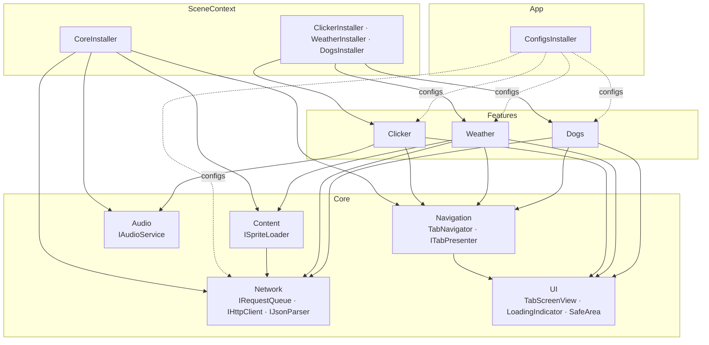
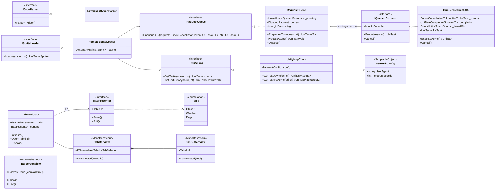
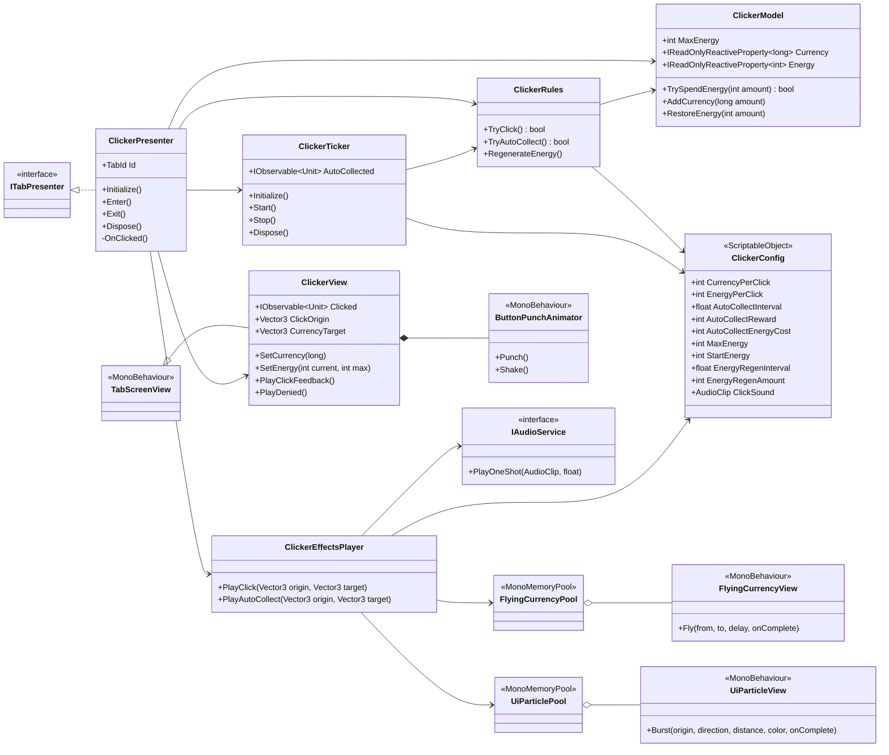
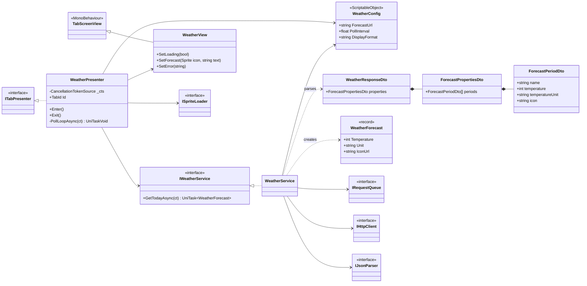
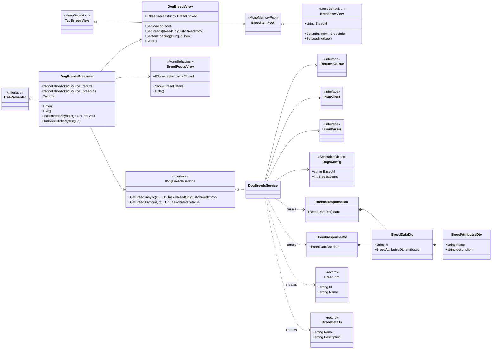
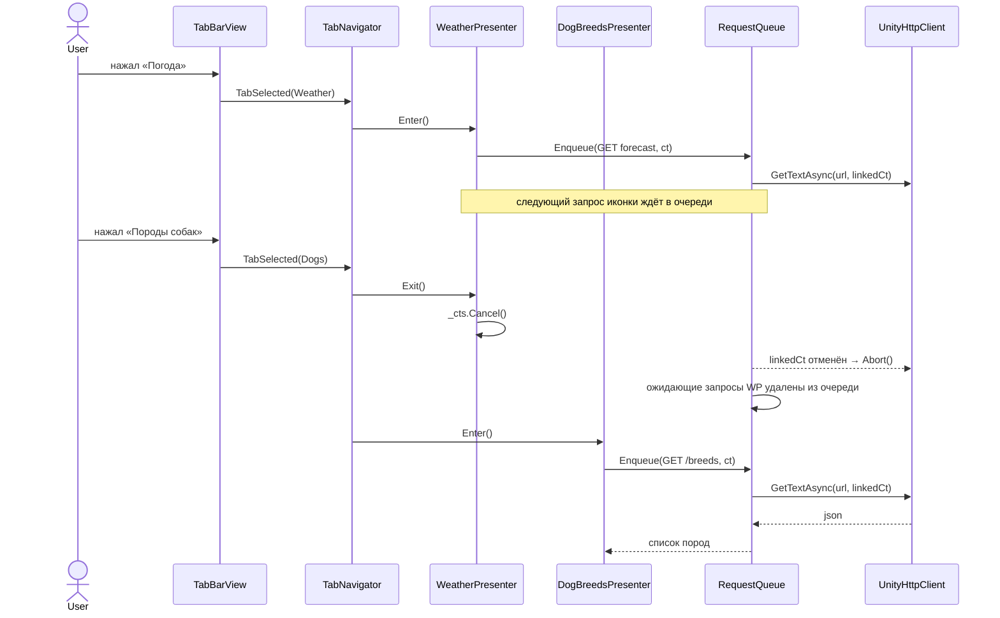

# Архитектура проекта — CKR System

Структура проекта, описание классов и UML-диаграммы (соответствует текущей реализации).
Стек: Unity 6000.5.6f1 (URP 2D), Zenject (Extenject), UniTask, UniRx, DOTween, UnityWebRequest, Newtonsoft.Json.

## 1. Принципы

- **MVP.** View — `MonoBehaviour`: только отрисовка и события ввода. Presenter — чистый C#: связывает View с Model и сервисами. Model и сервисы — чистый C# без зависимостей от сцены.
- **Без синглтонов и статики.** Все зависимости внедряются через Zenject. `AsSingle()` — это время жизни в DI-контейнере, а не паттерн Singleton.
- **Вкладка — это пара Presenter + View** с жизненным циклом `Enter()` / `Exit()`. Всё, что вкладка запускает (таймеры, запросы), принадлежит её `CancellationTokenSource` и отменяется в `Exit()`.
- **Все HTTP-запросы идут через `IRequestQueue`.** Очередь выполняет их строго по одному. Отмена через `CancellationToken`: если запрос ещё ждёт в очереди, он удаляется оттуда; если уже выполняется, вызывается `UnityWebRequest.Abort()`.
- **Конфигурация хранится в ScriptableObject.** В коде нет магических чисел: стоимости, награды, интервалы и URL лежат в конфигах.
- **Фичи не зависят друг от друга.** Каждая фича (`Clicker`, `Weather`, `Dogs`) зависит только от `Core`.

## 2. Структура папок

Namespace повторяет путь к файлу внутри `Scripts/Runtime` (например, `Features/Clicker/View/ClickerView.cs` → `TestTask.Features.Clicker.View`).

```
Assets/
├── _Project/
│   ├── Scripts/
│   │   ├── Runtime/                      TestTask.Runtime.asmdef
│   │   │   ├── App/
│   │   │   │   └── Installers/           ConfigsInstaller (ScriptableObjectInstaller, корень композиции)
│   │   │   ├── Core/
│   │   │   │   ├── Installers/           CoreInstaller
│   │   │   │   ├── Network/              IRequestQueue, RequestQueue, IQueuedRequest, QueuedRequest<T>,
│   │   │   │   │                         IHttpClient, UnityHttpClient, IJsonParser, NewtonsoftJsonParser,
│   │   │   │   │                         NetworkConfig, HttpRequestException
│   │   │   │   ├── Navigation/           TabId, ITabPresenter, TabNavigator
│   │   │   │   │   └── View/             TabBarView, TabButtonView
│   │   │   │   ├── UI/                   TabScreenView, LoadingIndicatorView, SafeAreaFitter
│   │   │   │   ├── Audio/                IAudioService, AudioService
│   │   │   │   └── Content/              ISpriteLoader, RemoteSpriteLoader
│   │   │   └── Features/
│   │   │       ├── Clicker/
│   │   │       │   ├── Config/           ClickerConfig
│   │   │       │   ├── Model/            ClickerModel
│   │   │       │   ├── Logic/            ClickerRules, ClickerTicker
│   │   │       │   ├── Presenter/        ClickerPresenter
│   │   │       │   ├── View/             ClickerView
│   │   │       │   ├── Effects/          ClickerEffectsPlayer, FlyingCurrencyView (+Pool),
│   │   │       │   │                     UiParticleView (+Pool), ButtonPunchAnimator
│   │   │       │   └── Installers/       ClickerInstaller
│   │   │       ├── Weather/
│   │   │       │   ├── Config/           WeatherConfig
│   │   │       │   ├── Data/             WeatherResponseDto, ForecastPropertiesDto, ForecastPeriodDto, WeatherForecast
│   │   │       │   ├── Service/          IWeatherService, WeatherService
│   │   │       │   ├── Presenter/        WeatherPresenter
│   │   │       │   ├── View/             WeatherView
│   │   │       │   └── Installers/       WeatherInstaller
│   │   │       └── Dogs/
│   │   │           ├── Config/           DogsConfig
│   │   │           ├── Data/             BreedsResponseDto, BreedResponseDto, BreedDataDto,
│   │   │           │                     BreedAttributesDto, RangeDto, BreedInfo, BreedDetails
│   │   │           ├── Service/          IDogBreedsService, DogBreedsService
│   │   │           ├── Presenter/        DogBreedsPresenter
│   │   │           ├── View/             DogBreedsView, BreedItemView (+Pool), BreedPopupView
│   │   │           └── Installers/       DogsInstaller
│   │   └── Editor/                       TestTask.Editor.asmdef
│   │       └── SceneBuilder/             MainSceneBuilder, UiFactory, SerializedSetter, ClickSoundGenerator
│   ├── Tests/EditMode/                   TestTask.Tests.EditMode.asmdef — RequestQueueTests, ClickerModelTests
│   ├── Configs/                          *Config.asset, ConfigsInstaller.asset
│   ├── Prefabs/
│   │   ├── UI/                           LoadingIndicator, ScreenTitle, TabButton, BreedItem
│   │   └── Effects/                      FlyingCurrency, UiParticle
│   └── Audio/                            Click.wav
├── Plugins/UniRx/                        исходники UniRx (MIT); в asmdef добавлена ссылка на UnityEngine.UI
├── Plugins/Demigiant/                    DOTween (импорт из Asset Store)
└── Scenes/Main.unity
Docs/                                     этот файл
```

UI лежит прямо в сцене `Main.unity` и в префабах, его правят в редакторе как обычно. Повторяющиеся блоки вынесены в префабы, и у каждого есть свой скрипт: `LoadingIndicator` (`LoadingIndicatorView`), `ScreenTitle` (`ScreenTitleView`), `TabButton` (`TabButtonView`), `BreedItem` (`BreedItemView`, внутри вложенный `LoadingIndicator`), `FlyingCurrency` и `UiParticle`. В сцене это экземпляры префабов, а их отличия (текст, `TabId`, размер) хранятся как overrides.

Editor-скрипт `MainSceneBuilder` оставлен как резервный: **Tools → TestTask → Legacy → Rebuild Main Scene (overwrites UI)**. Он пересоздаёт UI сцены и UI-префабы с нуля, ручные правки при этом теряются, поэтому перед запуском он спрашивает подтверждение.

## 3. Классы

### 3.1 Инсталлеры

На объекте `SceneContext` висят четыре `MonoInstaller` и подключён один `ScriptableObjectInstaller`.

| Класс | Тип | Назначение |
|---|---|---|
| `ConfigsInstaller` | `ScriptableObjectInstaller` | Биндит все конфиги (`NetworkConfig`, `ClickerConfig`, `WeatherConfig`, `DogsConfig`) через `BindInstance`. Лежит в `App`: это корень композиции, который знает обо всех фичах. |
| `CoreInstaller` | `MonoInstaller` | Инфраструктура: `RequestQueue`, `UnityHttpClient`, `NewtonsoftJsonParser`, `RemoteSpriteLoader`, `AudioService`, `TabNavigator` (с `BindExecutionOrder`, чтобы он инициализировался после презентеров). |
| `ClickerInstaller` | `MonoInstaller` | View, модель (`FromMethod` из конфига), правила, тикер, эффекты, пулы `FlyingCurrencyView` и `UiParticleView`, презентер. |
| `WeatherInstaller` | `MonoInstaller` | View, `WeatherService`, презентер. |
| `DogsInstaller` | `MonoInstaller` | View, поп-ап, пул `BreedItemView`, `DogBreedsService`, презентер. |

### 3.2 Core / Network

| Класс | Назначение |
|---|---|
| `IRequestQueue` | `UniTask<T> Enqueue<T>(Func<CancellationToken, UniTask<T>> request, CancellationToken ct)`. Единственная точка входа для сетевых операций. |
| `RequestQueue` | Реализация (`IRequestQueue`, `IDisposable`). Хранит `LinkedList<IQueuedRequest>` ожидающих запросов и один текущий. Цикл обработки берёт следующий запрос только после завершения предыдущего. `Dispose()` отменяет всё. |
| `IQueuedRequest` / `QueuedRequest<T>` | Элемент очереди. Оборачивает делегат и `UniTaskCompletionSource<T>`, подписан на токен вызывающей стороны. Если токен отменён, пока запрос ждёт, элемент удаляется из очереди и задача завершается как отменённая. Если запрос уже выполняется, отменяется связанный CTS, и `UnityHttpClient` прерывает `UnityWebRequest`. |
| `IHttpClient` | `GetTextAsync(url, ct)`, `GetTextureAsync(url, ct)`. Абстракция над транспортом, позволяет подменить его в тестах. |
| `UnityHttpClient` | Реализация на `UnityWebRequest` / `UnityWebRequestTexture`. Добавляет заголовки из `NetworkConfig` (api.weather.gov требует `User-Agent`), задаёт таймаут, при отмене делает `Abort()`. Ошибки превращает в `HttpRequestException`. Сам **не** использует очередь: в очередь его ставят сервисы. |
| `IJsonParser` / `NewtonsoftJsonParser` | `T Parse<T>(string json)`. Newtonsoft нужен потому, что `JsonUtility` плохо работает с вложенными DTO и JSON:API. |
| `NetworkConfig` | SO: `User-Agent`, таймаут. |
| `HttpRequestException` | Ошибка сети или HTTP (код, url). |

### 3.3 Core / Navigation и UI

| Класс | Назначение |
|---|---|
| `TabId` | `enum { Clicker, Weather, Dogs }`. |
| `ITabPresenter` | `TabId Id`, `void Enter()`, `void Exit()`. Его реализует каждая вкладка. |
| `TabNavigator` | `IInitializable`, `IDisposable`. Получает `List<ITabPresenter>` и `TabBarView`, подписан на `TabBarView.TabSelected`. При переключении вызывает `current.Exit()`, затем `next.Enter()`, затем `TabBarView.SetSelected(id)`. Открывает стартовую вкладку. |
| `TabBarView` | Нижняя панель. `IObservable<TabId> TabSelected`, `SetSelected(TabId)`. |
| `TabButtonView` | Кнопка вкладки: `TabId`, `Button`, состояние выделения. |
| `TabScreenView` | Базовый класс экранов вкладок. `Show()` / `Hide()` включают и выключают объект, `IsVisible`. |
| `LoadingIndicatorView` | Переиспользуемый индикатор загрузки: вращающийся квадрат (DOTween). `SetVisible(bool)`. |
| `SafeAreaFitter` | Подгоняет `RectTransform` под `Screen.safeArea`. Вместе с `CanvasScaler` (Scale With Screen Size) отвечает за адаптивность. |

### 3.4 Core / Audio и Content

| Класс | Назначение |
|---|---|
| `IAudioService` / `AudioService` | `PlayOneShot(AudioClip)`. `AudioSource` берётся из сцены через DI. |
| `ISpriteLoader` / `RemoteSpriteLoader` | `UniTask<Sprite> LoadAsync(url, ct)`. Загружает иконки (погоды) **через `IRequestQueue`** и кэширует их по url. |

### 3.5 Feature: Clicker

Автосбор и восстановление энергии работают всегда, даже когда открыта другая вкладка. Автосбор тратит энергию: если её не хватает, тик пропускается.

| Класс | Тип | Назначение |
|---|---|---|
| `ClickerConfig` | SO | `CurrencyPerClick` (1), `EnergyPerClick` (1), `AutoCollectInterval` (3 с), `AutoCollectReward` (1), `AutoCollectEnergyCost` (1), `MaxEnergy` (1000), `StartEnergy` (1000), `EnergyRegenInterval` (10 с), `EnergyRegenAmount` (10), а также параметры эффектов и звук клика. |
| `ClickerModel` | C# | Состояние: `IReadOnlyReactiveProperty<long> Currency`, `IReadOnlyReactiveProperty<int> Energy`, `MaxEnergy`. Операции `TrySpendEnergy`, `AddCurrency`, `RestoreEnergy` (не выше максимума). Ничего не знает ни о Unity, ни о конфиге. |
| `ClickerRules` | C# | Игровые правила поверх модели и конфига: `TryClick()`, `TryAutoCollect()`, `RegenerateEnergy()`. |
| `ClickerTicker` | `IInitializable`, `IDisposable` | Таймеры UniRx `Observable.Interval`: автосбор и восстановление энергии. `Start()` / `Stop()`, событие `AutoCollected` для эффектов. |
| `ClickerPresenter` | `ITabPresenter`, `IInitializable`, `IDisposable` | Биндит `Currency`/`Energy` на View. Клик: если `rules.TryClick()` прошёл, проигрывает анимацию кнопки и `effects.PlayClick()`, иначе `view.PlayDenied()` (тряска кнопки). Пока вкладка видна, показывает эффект автосбора. |
| `ClickerView` | `TabScreenView` | Кнопка, текст валюты с иконкой, полоска энергии. `Clicked`, `SetCurrency`, `SetEnergy`, `PlayClickFeedback`, `PlayDenied`, точки для эффектов `ClickOrigin` / `CurrencyTarget`. |
| `ClickerEffectsPlayer` | C# | Эффекты клика в одном месте: звук через `IAudioService`, разлёт частиц и полёт монеток из пулов. |
| `FlyingCurrencyView` (+`Pool`) | MonoBehaviour | Квадратик валюты, летит от кнопки к счётчику (`DOJump`), по завершении возвращается в пул. |
| `UiParticleView` (+`Pool`) | MonoBehaviour | UI-частица: квадратик разлетается и гаснет. Сделана на UI, чтобы рисоваться поверх Canvas в режиме Overlay. |
| `ButtonPunchAnimator` | MonoBehaviour | `Punch()` и `Shake()` кнопки через DOTween. |

### 3.6 Feature: Weather

| Класс | Тип | Назначение |
|---|---|---|
| `WeatherConfig` | SO | `ForecastUrl` (`https://api.weather.gov/gridpoints/TOP/32,81/forecast`), `PollIntervalSeconds` (5 с), формат строки `DisplayFormat` (`"Сегодня - {0}{1}"`). |
| `WeatherResponseDto`, `ForecastPropertiesDto`, `ForecastPeriodDto` | DTO | Повторяют JSON: `properties.periods[]` → `name`, `temperature`, `temperatureUnit`, `icon`. |
| `WeatherForecast` | C# record | Доменная модель: `Temperature`, `Unit`, `IconUrl`. |
| `IWeatherService` / `WeatherService` | C# | `UniTask<WeatherForecast> GetTodayAsync(ct)`: ставит запрос в `IRequestQueue`, парсит ответ и берёт первый период. |
| `WeatherPresenter` | `ITabPresenter` | В `Enter()` создаёт CTS и запускает цикл: запросить прогноз, загрузить иконку через `ISpriteLoader`, показать, подождать `PollIntervalSeconds`, повторить. В `Exit()` отменяет CTS, а с ним и текущий, и ожидающий запрос в очереди. Ошибки показывает во View, и цикл продолжается. |
| `WeatherView` | `TabScreenView` | `Image` иконки, `Text`, `LoadingIndicatorView`. Методы `ResetState`, `SetLoading`, `SetForecast(Sprite, string)`, `SetError(string)`. |

### 3.7 Feature: Dogs

| Класс | Тип | Назначение |
|---|---|---|
| `DogsConfig` | SO | `BaseUrl` (`https://dogapi.dog/api/v2`), `BreedsCount` (10). |
| `BreedsResponseDto`, `BreedResponseDto`, `BreedDataDto`, `BreedAttributesDto` | DTO | Формат JSON:API: `data[]` / `data` → `id`, `attributes.name`, `attributes.description`. |
| `BreedInfo` | C# record | `Id`, `Name` — элемент списка. |
| `BreedDetails` | C# record | `Name`, `Description` — содержимое поп-апа. |
| `IDogBreedsService` / `DogBreedsService` | C# | `GetBreedsAsync(ct)` возвращает `IReadOnlyList<BreedInfo>` (`/breeds`, первые N), `GetBreedAsync(id, ct)` возвращает `BreedDetails` (`/breeds/{id}`). Оба метода работают через `IRequestQueue`. |
| `DogBreedsPresenter` | `ITabPresenter` | `Enter()`: создаёт `_tabCts`, показывает лоадер, загружает список и заполняет View. Клик по породе: отменяет `_breedCts` предыдущей породы (её запрос удаляется из очереди или прерывается), создаёт новый связанный с `_tabCts` токен, включает лоадер на элементе, загружает детали и открывает поп-ап. `Exit()`: отменяет оба CTS и закрывает поп-ап. |
| `DogBreedsView` | `TabScreenView` | Контейнер списка, лоадер. `SetBreeds(IReadOnlyList<BreedInfo>)` (берёт элементы из пула), `IObservable<string> BreedClicked`, `SetItemLoading(id, bool)`, `SetError`, `Clear`. Пул элементов получает через `[Inject]`. |
| `BreedItemView` (+`Pool`) | MonoBehaviour | Строка «1 - Akita»: кнопка и индикатор загрузки. Берётся из пула `MonoMemoryPool`. |
| `BreedPopupView` | MonoBehaviour | Заголовок, описание, кнопка закрытия. `Show(BreedDetails)` / `Hide()` с анимацией DOTween, `HideImmediate()`. `IObservable<Unit> CloseRequested`: кнопка «Закрыть» или клик по затемнению. |

## 4. UML

### 4.1 Модули и зависимости



### 4.2 Core: сеть и навигация



### 4.3 Clicker



### 4.4 Weather



### 4.5 Dogs



### 4.6 Последовательность: смена вкладки отменяет запросы



## 5. Биндинги Zenject

```csharp
// CoreInstaller (MonoInstaller на SceneContext)
Container.BindInterfacesTo<RequestQueue>().AsSingle();
Container.BindInterfacesTo<UnityHttpClient>().AsSingle();
Container.BindInterfacesTo<NewtonsoftJsonParser>().AsSingle();
Container.BindInterfacesTo<RemoteSpriteLoader>().AsSingle();
Container.BindInstance(_audioSource).AsSingle();
Container.BindInterfacesTo<AudioService>().AsSingle();
Container.BindInstance(_tabBar).AsSingle();
Container.BindInterfacesAndSelfTo<TabNavigator>().AsSingle();
Container.BindExecutionOrder<TabNavigator>(100);           // после презентеров

// ClickerInstaller
Container.BindInstance(_view).AsSingle();
Container.BindInterfacesAndSelfTo<ClickerModel>()
    .FromMethod(ctx => { var c = ctx.Container.Resolve<ClickerConfig>(); return new ClickerModel(c.MaxEnergy, c.StartEnergy); })
    .AsSingle();
Container.Bind<ClickerRules>().AsSingle();
Container.BindInterfacesAndSelfTo<ClickerTicker>().AsSingle();
Container.Bind<ClickerEffectsPlayer>().AsSingle();
Container.BindMemoryPool<FlyingCurrencyView, FlyingCurrencyView.Pool>()
    .WithInitialSize(10).FromComponentInNewPrefab(_flyingCurrencyPrefab).UnderTransform(_effectsLayer);
Container.BindMemoryPool<UiParticleView, UiParticleView.Pool>()
    .WithInitialSize(20).FromComponentInNewPrefab(_particlePrefab).UnderTransform(_effectsLayer);
Container.BindInterfacesAndSelfTo<ClickerPresenter>().AsSingle();   // попадает в List<ITabPresenter>
```

## 6. Тесты (EditMode)

- `RequestQueueTests`:
  - запросы выполняются по одному и в порядке постановки;
  - отмена ожидающего запроса удаляет его из очереди, и он не стартует;
  - отмена активного запроса отменяет токен, переданный в делегат, после чего очередь продолжает работу;
  - уже отменённый токен сразу даёт отменённую задачу;
  - упавший запрос не блокирует очередь.
- `ClickerModelTests`: нельзя потратить больше энергии, чем есть; восстановление и стартовая энергия не превышают `MaxEnergy`; валюта накапливается.

Запуск: **Window → General → Test Runner → EditMode → Run All**.
